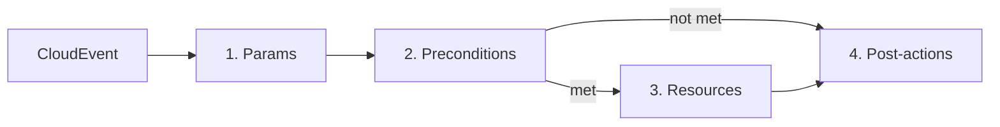
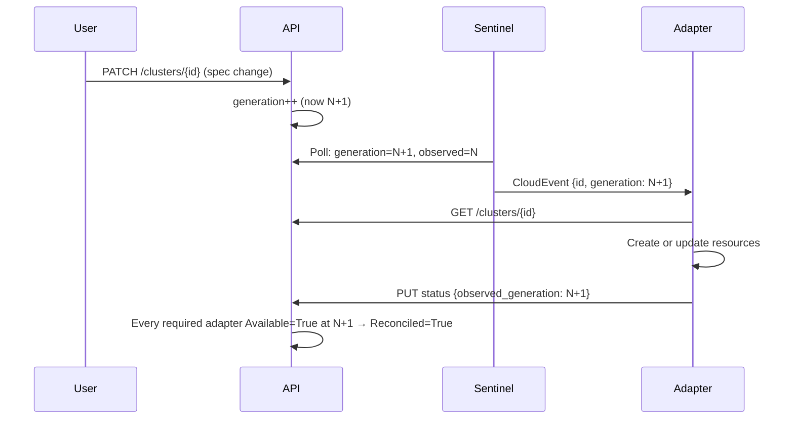

# HyperFleet Adapter Authoring Guide

> **Audience:** Engineers who write adapter task configs. You need to know Kubernetes and YAML. You do not need to know Go.

> **Version:** This guide covers v2 task configs, which declare `schema_version: "2.0"`. For a v1 task config, use the [v0.3.1 guide](https://github.com/openshift-hyperfleet/hyperfleet-adapter/blob/v0.3.1/docs/adapter-authoring-guide.md). [Concepts changed in v2](adapter-authoring-reference.md#concepts-changed-in-v2) lists what changed.

The [Adapter Authoring Reference](adapter-authoring-reference.md) holds the syntax tables, the validation errors and the edge-case behavior. This guide links to it where you need it.

| Section | You learn |
|---|---|
| [What an adapter does](#what-an-adapter-does) | The pass, its four phases, the status report, and the terms this guide uses |
| [Your first task](#your-first-task) | A complete task config, checked and run without a cluster |
| [Params](#params) | How to read values from the event, the environment and the API |
| [Preconditions](#preconditions) | How to decide whether the resources phase runs |
| [Resources and discovery](#resources-and-discovery) | How to apply Kubernetes objects and read them back |
| [Remote transports](#remote-transports) | How to deliver objects to another cluster |
| [The eventual-consistency contract for remote reads](#the-eventual-consistency-contract-for-remote-reads) | How to read remote objects, and how to report conditions on them |
| [Ordering and deletion](#ordering-and-deletion) | How to order resources and delete them when the cluster is deleted |
| [Status reporting](#status-reporting) | How to build the status report and send it to the API |
| [Worked example](#worked-example) | Two ordered remote resources, pass by pass |
| [NodePool adapters](#nodepool-adapters) | What changes for a node pool adapter |
| [Test and deploy](#test-and-deploy) | Dry runs, validation and deployment |

---

## What an adapter does

An adapter reacts to changes of one HyperFleet resource kind, for example clusters or node pools. For each change, it applies Kubernetes objects and reports their status to the HyperFleet API. You do not write Go code. You write a YAML task config, and the adapter binary runs it.

Your own logic runs in the Kubernetes objects: a Job that validates something, a Deployment that provisions something. The adapter reads their status and reports it to the API.

### One pass

1. A user changes a cluster in the HyperFleet API.
2. The Sentinel, a HyperFleet service that watches the API, publishes a CloudEvent to the message broker.
3. The adapter receives the event and runs its task config once. One run of the task config for one event is a **pass**.

A pass has four phases:



| Phase | What it does |
|---|---|
| Params | Reads values from the event, the environment and the HyperFleet API |
| Preconditions | Decides whether the resources phase runs |
| Resources | Applies Kubernetes objects and reads them back |
| Post-actions | Builds a status report and sends it to the API |

The post-actions run even when the preconditions are not met or a resource fails. So the adapter reports its state in almost every pass. A pass ends without a report in these cases:

- A required param cannot be resolved, for example because the API returns 404 for the cluster.
- A deprecated precondition `api_call` returns "resource not found".
- A payload fails to build, or a post-action fails before the report is sent. See [Gate payloads and post-actions with `when`](#gate-payloads-and-post-actions-with-when).

[404 handling](adapter-authoring-reference.md#404-handling) lists what a 404 does in each phase.

### Generation and the reconcile loop

Every spec change increments the `generation` of the resource. The adapter reports `observed_generation` with its status. The API sets the resource's `Reconciled` condition when every required adapter reports `Available=True` at the current generation. While the resource is being deleted, `Reconciled` needs `Finalized=True` from every required adapter instead; see [How deletion works](#how-deletion-works).



While the resource is not reconciled, the Sentinel keeps publishing events for it. After the resource is reconciled, the Sentinel still publishes an event when the `Reconciled` condition has not been updated for a maximum age. The default is 30 minutes.

The adapter does not wait for a workload to finish. It reads the status that the objects have during the pass and reports it. For example, a new Job still runs on the first pass, so the adapter reports `Available=Unknown`. A later pass reads the Job again and reports `True`. So you do not write polling or retries. You write expressions that read the current state correctly.

### Events carry only an ID

An event identifies the changed resource and nothing more:

```json
{
  "data": {
    "id": "abc123",
    "kind": "Cluster",
    "href": "/api/hyperfleet/v1/clusters/abc123",
    "generation": 5
  }
}
```

The adapter fetches the full resource from the API in the params phase. Take `generation` from that API response, not from the event. The API has the current value. A NodePool event can also carry the ID of its cluster; see [NodePool adapters](#nodepool-adapters).

### What the adapter reports

Every report has the `Applied`, `Available` and `Health` conditions. The API rejects a report without one of them.

| Condition | Question | Read from |
|---|---|---|
| `Applied` | Do the objects exist? | `resource_states` |
| `Available` | Do the objects work? Did the Job complete, is the Namespace `Active`? | The status of your objects |
| `Health` | Did the adapter run without errors? | `adapter.*`, with the standard condition in [Your first task](#write-the-task-config) |
| `Finalized` | Is cleanup complete? Needed during deletion: the API deletes the resource only after every required adapter reports `Finalized=True` | See [Report cleanup with Finalized](#report-cleanup-with-finalized) |

Each condition is `True`, `False` or `Unknown`, as the answer to its question in the table:

- `True`: the answer is yes.
- `False`: the answer is no. For `Available`, an object is missing, failed, or not ready.
- `Unknown`: the adapter cannot tell yet, for example while a Job runs or a remote mirror lags.

**The API treats `Available=Unknown` in a special way.** Your adapter's first report is stored, but the API does not use it for aggregation while `Available` is `Unknown`. After the first report, the API discards every report with `Available=Unknown`. It discards the whole report, with all its other conditions, `Finalized` and `Health` too. So decide `Available` whenever another condition in the report matters.

### Config files

| File | Holds | Described in |
|---|---|---|
| Deployment config (`adapter-config.yaml`) | Adapter name, API and broker clients, Kubernetes client, named stores and transports | [Configuration Reference](configuration.md) |
| Task config (`adapter-task-config.yaml`) | `params`, `preconditions`, `resources` and `post` | This guide |
| Broker config (`broker.yaml`) | Broker connection. The Helm chart builds it | [Deployment Guide](deployment.md#broker-configuration) |

The examples in this guide manage clusters. The same task structure works for any resource kind. For another kind, change the API paths (`/clusters/{{ .resourceId }}`) and the labels such as `hyperfleet.io/cluster-id`.

### Three expression languages

| Language | Syntax | Use it for |
|---|---|---|
| Go templates | `{{ .resourceId }}` | Inserting a value into a string: URLs, manifest fields, payload values |
| CEL | `expression: "..."` | Logic: comparisons, conditionals, lists |
| Field path | `field: "status.phase"` | Reading one value by path. The path starts from the same names that CEL reads. In a precondition capture, it starts from the API response |

The CEL syntax that this guide uses:

| CEL | Meaning |
|---|---|
| `a.?b` | Field `b` of `a`, or "no value" if `b` is missing. `a` itself must exist: an unset param fails the expression |
| `x.orValue(d)` | The value of `x`, or `d` if there is no value |
| `m[?"key"]` | The entry `key` of map `m`, or "no value" |
| `has(a.b)`, `a.?b.hasValue()` | `true` if field `b` exists |
| `cond ? x : y` | `x` if `cond` is true, otherwise `y` |
| `string(n)` | `n` as a string |

Use `.?` and `orValue()` for every field that can be missing. Without them, a missing field makes the expression fail. The task config also has helper functions such as `conditionStatus()` and `stableFor()`. The [CEL quick reference](adapter-authoring-reference.md#cel-quick-reference) lists them.

### Terms

- **Transport:** where a resource goes. The default is the local Kubernetes API. A remote transport delivers to another cluster.
- **Store:** where a remote transport writes manifests.
- **Target cluster:** the cluster that a remote transport delivers to.
- **Remote cluster side:** [hyperfleet-applier](https://github.com/openshift-hyperfleet/hyperfleet-applier), which applies what a remote transport writes to the store. An operator deploys it; see [Transports and stores](configuration.md#transports-and-stores).
- **Mirror:** the copy of a remote object that the remote cluster side writes back. The adapter reads the mirror, not the target cluster.

---

## Your first task

This task manages one local resource: a Namespace for each cluster. It reports the `Applied`, `Available` and `Health` conditions. You write two files, check them, and run one pass without a cluster, a broker or an API server.

You need the adapter binary. Clone the [hyperfleet-adapter](https://github.com/openshift-hyperfleet/hyperfleet-adapter) repository and run `make build`, which builds `bin/hyperfleet-adapter`. Save the two files in the repository root, and run the commands there.

### Write the deployment config

Save this as `adapter-config.yaml`:

```yaml
adapter:
  name: my-adapter
clients:
  hyperfleet_api:
    base_url: "http://hyperfleet-api:8000"
    timeout: 10s
    retry_attempts: 3
    retry_backoff: exponential
  broker:
    subscription_id: "my-adapter"   # unique per adapter; a shared ID makes adapters compete for events
    topic: "hyperfleet-clusters"
  kubernetes:
    api_version: "v1"
```

### Write the task config

Save this as `adapter-task-config.yaml`:

```yaml
schema_version: "2.0"  # Required on every task

params:               # Phase 1: read values from the event and the API
  - name: "resourceId"
    source: "event.id"
    type: "string"
    required: true

  - name: "resourceStatus"
    source:
      api_call:
        method: "GET"
        url: "/api/hyperfleet/v1/clusters/{{ .resourceId }}"
        timeout: 10s
        retry_attempts: 3
        retry_backoff: "exponential"

  - name: "generation"
    source: "resourceStatus.generation"
    type: "int"
    required: true

preconditions: []     # Phase 2: none, so the resources phase always runs

resources:            # Phase 3: apply objects and read them back
  - name: "namespace"
    manifest:
      apiVersion: v1
      kind: Namespace
      metadata:
        name: "{{ .resourceId }}"
        labels:
          hyperfleet.io/cluster-id: "{{ .resourceId }}"
          hyperfleet.io/managed-by: "{{ .adapter.name }}"
          hyperfleet.io/resource-type: "namespace"
        annotations:
          hyperfleet.io/generation: "{{ .generation }}"
    discovery:
      by_name: "{{ .resourceId }}"

post:                 # Phase 4: build the status report and send it
  payloads:
    - name: "statusPayload"
      build:
        adapter: "{{ .adapter.name }}"
        conditions:
          - type: "Applied"
            status:
              expression: |
                resource_states.?namespace.orValue("") == "present" ? "True" : "False"
            reason:
              expression: |
                resource_states.?namespace.orValue("") == "present" ? "Applied" : "Pending"
            message:
              expression: |
                resource_states.?namespace.orValue("") == "present"
                  ? "Resources applied successfully"
                  : "Resources pending"

          - type: "Available"
            status:
              expression: |
                resources.?namespace.?status.?phase.orValue("") == "Active"
                  ? "True" : "False"
            reason:
              expression: |
                resources.?namespace.?status.?phase.orValue("") == "Active"
                  ? "NamespaceReady" : "NamespaceNotReady"
            message:
              expression: |
                resources.?namespace.?status.?phase.orValue("") == "Active"
                  ? "Namespace is active" : "Namespace not yet active"

          # The standard Health condition. Copy it into your adapter and leave it as-is.
          - type: "Health"
            status:
              expression: |
                adapter.?executionStatus.orValue("") == "success"
                  && !adapter.?resourcesSkipped.orValue(false)
                ? "True"
                : "False"
            reason:
              expression: |
                adapter.?executionStatus.orValue("") != "success"
                ? "ExecutionFailed:" + adapter.?executionError.?phase.orValue("unknown")
                : adapter.?resourcesSkipped.orValue(false)
                  ? "ResourcesSkipped"
                  : "Healthy"
            message:
              expression: |
                adapter.?executionStatus.orValue("") != "success"
                ? "Adapter failed at phase ["
                    + adapter.?executionError.?phase.orValue("unknown")
                    + "] step ["
                    + adapter.?executionError.?step.orValue("unknown")
                    + "]: "
                    + adapter.?executionError.?message.orValue(
                        adapter.?errorMessage.orValue("no details"))
                : adapter.?resourcesSkipped.orValue(false)
                  ? "Resources skipped: " + adapter.?skipReason.orValue("unknown reason")
                  : "Adapter execution completed successfully"

        observed_generation:
          expression: "generation"
        observed_time: "{{ now | date \"2006-01-02T15:04:05Z07:00\" }}"

  post_actions:
    - name: "reportStatus"
      api_call:
        method: "PUT"
        url: "/api/hyperfleet/v1/clusters/{{ .resourceId }}/statuses"
        body: "{{ .statusPayload }}"
```

What each part does:

- `params` reads the cluster ID from the event, fetches the cluster from the API, and takes its `generation`.
- `preconditions` is empty, so the resources phase runs on every pass.
- `resources` applies one Namespace and reads it back by name. Every manifest needs the `hyperfleet.io/generation` annotation.
- `post` builds the status report and sends it to the API. `Applied` and `Available` read the Namespace. `Health` reports whether the adapter itself ran without errors.

The task does not handle deletion yet. It has no `Finalized` condition, so the API cannot delete a cluster while this adapter is required. [Report cleanup with Finalized](#report-cleanup-with-finalized) adds it.

The rest of this guide explains each part in that order.

### Check the config

`config-dump` loads and validates both files, with the same checks as `serve`. It prints the merged config as YAML, or it exits non-zero with the error:

```bash
HYPERFLEET_TRACING_ENABLED=false bin/hyperfleet-adapter config-dump \
  --config adapter-config.yaml \
  --task-config adapter-task-config.yaml
```

The binary exports traces by default. `HYPERFLEET_TRACING_ENABLED=false` stops it from trying to reach a collector.

### Run a dry run

A dry run processes one event with a mock API and a mock cluster. The repository has sample inputs. `test/testdata/dryrun/event.json` is an event for cluster `abc123`. `test/testdata/dryrun/dryrun-api-responses.json` returns that cluster at generation 77 and accepts the status `PUT`:

```bash
HYPERFLEET_TRACING_ENABLED=false bin/hyperfleet-adapter serve \
  --config adapter-config.yaml \
  --task-config adapter-task-config.yaml \
  --dry-run-event test/testdata/dryrun/event.json \
  --dry-run-api-responses test/testdata/dryrun/dryrun-api-responses.json
```

The trace shows each phase. This is an abridged copy. The param lines can appear in a different order:

```
Dry-Run Execution Trace
========================
Event: id=abc123 type=io.hyperfleet.cluster.updated

Phase 1: Parameter Extraction .............. SUCCESS
  resourceId       = "abc123"
  resourceStatus   = {"generation":77,...}
  generation       = 77
  API Call: GET /api/hyperfleet/v1/clusters/abc123 -> 200

Phase 2: Preconditions ..................... SUCCESS

Phase 3: Resources ........................ SUCCESS
  [1/1] namespace                      CREATE
    Kind: Namespace    Namespace:              Name: abc123

Phase 3.5: Discovery Results ................. (available as resources.* in payload)
  namespace:
    {
      "apiVersion": "v1",
      "kind": "Namespace",
      ...
    }

Phase 4: Post Actions ..................... SUCCESS
  [1/1] reportStatus                   EXECUTED
    API Call: PUT /api/hyperfleet/v1/clusters/abc123/statuses -> 200

Result: SUCCESS
```

The report has these conditions:

| Condition | Status | Reason |
|---|---|---|
| `Applied` | `True` | `Applied` |
| `Available` | `False` | `NamespaceNotReady` |
| `Health` | `True` | `Healthy` |

The operation is `CREATE` because the mock cluster starts empty. The mock returns the applied manifest as the discovered object. That object has no `status.phase`, so `Available` is `False`. A real cluster sets the phase of a new Namespace to `Active`, so `Available` is `True` there. To simulate a real object, give the dry run a discovery file. [Dry-run mode](#dry-run-mode) explains the inputs and a development loop.

---

## Params

Params are named values. The adapter resolves them in list order, so a param can use any param above it. A Go template reads a param as `{{ .name }}`, and CEL reads it as `name`.

### Sources

A `source` string reads one value:

| Prefix | Reads | Example |
|---|---|---|
| `event.` | A field of the CloudEvent data | `event.id`, `event.generation` |
| `env.` | An environment variable | `env.REGION` |
| `config.` | A field of the deployment config | `config.adapter.name` |
| `<param>.` | A field of an earlier `api_call` param | `resourceStatus.generation` |
| `adapter.` | Adapter metadata | `adapter.name`, `adapter.version` |

A `source` mapping runs something:

```yaml
params:
  # file: read a file on every pass, for example a token that rotates. A relative path is read from /.
  - name: "k8sToken"
    source:
      file:
        path: "/var/run/secrets/kubernetes.io/serviceaccount/token"
        trim: true   # the default; removes leading and trailing whitespace

  # api_call: GET from the HyperFleet API. The param holds the whole JSON response as a map.
  - name: "resourceStatus"
    source:
      api_call:
        method: "GET"
        url: "/api/hyperfleet/v1/clusters/{{ .resourceId }}"   # a Go template
        timeout: 10s
        retry_attempts: 3
        retry_backoff: "exponential"   # or linear, constant
        headers:                       # only if the API needs a bearer token
          - name: "Authorization"
            value: "Bearer {{ .k8sToken }}"

  # expression: CEL over the params above
  - name: "reconciledStatus"
    source:
      expression: |
        conditionStatus(resourceStatus.status.conditions, "Reconciled")
```

> **Security:** A token in a header is a credential. Make sure that request logs, proxies and service meshes do not record the `Authorization` header.

`conditionStatus()` returns `"Unknown"` when the object has no condition of that type. So compare with `!= "True"` when you mean "not true now". A missing condition then counts as "not true".

### Types, required and default

| `type` | Accepts |
|---|---|
| none | No conversion. The value keeps its JSON type, so numbers are floats |
| `string` | Any value, converted to text |
| `int`, `int64` | Integers, numeric strings, floats (truncated) |
| `float`, `float64` | Numbers |
| `bool` | `true`/`false`, `yes`/`no`, `on`/`off`, `1`/`0` |

`type` converts a `source` string or a `file` value. It has no effect on `api_call` and `expression` params. An `api_call` param holds a map, and an `expression` param holds what the CEL returns.

Set `type: "int"` on `generation`. Without it, a large generation renders as `1.234567e+06` in the annotation. The local transport then reads the generation as 0 and skips every update, and a remote transport rejects the manifest.

- If a **required** param fails, the pass ends. No post-actions run.
- If an optional param fails, it takes its `default`. Without a `default`, it stays unset.

**An unset param breaks CEL and templates.** An optional `source: "resourceStatus.deleted_time"` leaves the param unset while the field is absent. The adapter logs this only at debug level, and `config-dump` does not catch it. What reads the param then fails at runtime:

- A precondition counts as not met.
- A lifecycle gate counts as `false`.
- A payload expression logs `cel evaluation failed`.
- A Go template fails. In a payload, the pass sends no report. In a manifest, the resources phase fails.

To get a real `false`, derive a boolean with an `expression` source:

```yaml
  - name: "is_deleting"
    source:
      expression: "resourceStatus.?deleted_time.hasValue()"
```

---

## Preconditions

Preconditions decide whether the resources phase runs. They run in order, after the params. Every precondition must be met for the resources phase to run.

A precondition uses structured conditions or a CEL expression:

```yaml
preconditions:
  # Structured conditions: a field, an operator and a value
  - name: "notReconciled"
    conditions:
      - field: "reconciledStatus"
        operator: "notEquals"
        value: "True"

  # CEL: for logic that conditions cannot express
  - name: "hasGeneration"
    expression: |
      resourceStatus.generation > 0
```

The operators are `equals`, `notEquals`, `in`, `notIn`, `contains`, `greaterThan`, `lessThan` and `exists`. The loader rejects any other operator. For "does not exist" or "greater than or equal", use a CEL expression, for example `!has(resourceStatus.deleted_time)`. [Condition operators](adapter-authoring-reference.md#condition-operators) lists the value type of each operator.

When a precondition is not met, the adapter skips the resources phase and still runs the post-actions. It sets `adapter.resourcesSkipped` to `true`, and `adapter.skipReason` says why. The standard Health condition then reports `False` with reason `ResourcesSkipped`. This is often normal: the cluster is not ready yet, and a later pass tries again.

A precondition that fails with an error also skips the resources phase. Then `adapter.executionStatus` is `"failed"`, and the post-actions still run.

### Self-healing with a stability window

A common precondition runs the resources phase only while the cluster is not `Reconciled`. That covers the first deployment. But if someone deletes one of your objects after the cluster is `Reconciled`, the adapter never applies it again.

To fix this, also run the resources phase when the cluster has been `Reconciled` for a while:

```yaml
params:
  # resourceStatus as in "Your first task"
  - name: "resourceNotReconciled"
    source:
      expression: |
        conditionStatus(resourceStatus.status.conditions, "Reconciled") != "True"
  - name: "resourceReconciledTTL"
    source:
      expression: |
        stableFor(resourceStatus.status.conditions, "Reconciled", 300)

preconditions:
  - name: "validationCheck"
    # Run while not Reconciled, or once Reconciled has been stable for 300 seconds
    expression: |
      resourceNotReconciled || resourceReconciledTTL
```

A reconciled cluster still gets the Sentinel's max-age event (see [Generation and the reconcile loop](#generation-and-the-reconcile-loop)). On that pass the precondition is met, and the adapter applies a missing object again.

`stableFor()` is `true` only while the condition is `True` and its `last_transition_time` is at least that many seconds old. `last_transition_time` changes only when the status changes. In your own CEL, use it for a stability window, not `last_updated_time`, which changes on every report.

---

## Resources and discovery

Each resource is a Kubernetes manifest plus a `discovery` that reads the object back. The adapter processes resources in list order.

| Field | Required | Purpose |
|---|---|---|
| `name` | yes | The alias of the resource in CEL: `resources.<name>` and `resource_states.<name>`. A lowercase letter first, then letters, digits and underscores |
| `manifest` | yes | The object to deliver: an inline mapping, an inline block scalar, or a `ref` to a file |
| `discovery` | yes | How to find the object: `by_name` or `by_selectors` |
| `transport` | no | Where to deliver. Omit it for the local Kubernetes API. See [Transports](#transports) |
| `lifecycle` | no | `create.when` and `delete.when` gates. See [Ordering and deletion](#ordering-and-deletion) |
| `recreate_on_change` | no | Delete and recreate the object instead of updating it when the generation changes. Local transport only |

### The generation annotation

Add `hyperfleet.io/generation: "{{ .generation }}"` to the annotations of every manifest. The adapter compares it with the annotation on the existing object, and it chooses the operation:

| Operation | When |
|---|---|
| `create` | The object does not exist |
| `update` | The object exists and its generation differs from the manifest's. A remote transport refuses a lower generation; see [Generation write rules](adapter-authoring-reference.md#generation-write-rules) |
| `skip` | The object exists with the same generation. Also: the object does not exist and `lifecycle.create.when` is `false` |
| `recreate` | The generation differs and `recreate_on_change: true` is set |
| `delete` | `lifecycle.delete.when` is `true` |

Without the annotation:

- A remote transport rejects the manifest, and the resources phase fails.
- The local transport reads the generation as 0. It creates the object once and then skips every later update.

### Manifests

An inline mapping supports `{{ .var }}` in values:

```yaml
resources:
  - name: "namespace"
    manifest:
      apiVersion: v1
      kind: Namespace
      metadata:
        name: "{{ .resourceId }}"
        annotations:
          hyperfleet.io/generation: "{{ .generation }}"
    discovery:
      by_name: "{{ .resourceId }}"
```

The loader parses an inline mapping as YAML before it renders templates. So `{{ if }}` and `{{ range }}` do not work there. For those, write the manifest as a block scalar (`|`). The adapter then renders it as a raw template:

```yaml
resources:
  - name: "configMap"
    manifest: |
      apiVersion: v1
      kind: ConfigMap
      metadata:
        name: "{{ .resourceId }}-config"
        namespace: "default"
        annotations:
          hyperfleet.io/generation: "{{ .generation }}"
      data:
        cluster_id: "{{ .resourceId }}"
      {{ if eq .platformType "gcp" }}
        platform_tier: "cloud"
      {{ else }}
        platform_tier: "onprem"
      {{ end }}
    discovery:
      namespace: "default"
      by_name: "{{ .resourceId }}-config"
```

Here `platformType` is a param. For a large manifest, use a file. The file is a Go template too:

```yaml
    manifest:
      ref: "job.yaml"
```

A relative `ref` resolves against the directory of the task config, and it must stay inside that directory. In a deployment, mount the file next to the task config.

`apiVersion` and `kind` must be literal values. The loader reads them without rendering templates, and the rendered manifest must not change them. Each one must appear once, at the top level. If you put them in both branches of an `{{ if }}`, the load fails with `apiVersion is set more than once`.

### Discovery

After the apply, the adapter discovers the object: it reads the whole object back. Set exactly one of `by_name` and `by_selectors`:

```yaml
# By name
discovery:
  by_name: "{{ .resourceId }}"

# By label selector
discovery:
  namespace: "{{ .resourceId }}"       # omit for cluster-scoped kinds
  by_selectors:
    label_selector:
      hyperfleet.io/cluster-id: "{{ .resourceId }}"
      hyperfleet.io/resource-type: "job"
```

When a selector matches several objects, the adapter uses the one with the highest generation annotation.

CEL reads the discovered object as `resources.<name>`, with every field the cluster returns. CEL reads the discovery outcome as `resource_states.<name>`:

| `resource_states.<name>` | Meaning | `resources.<name>` |
|---|---|---|
| `present` | The object exists | The object |
| `confirmed_deleted` | The object was not found, and no work for it is pending. This is also the state of an object that was never created | Absent |
| `unsynced` | Not known yet. Remote transports only; see [the eventual-consistency contract](#the-eventual-consistency-contract-for-remote-reads) | The last known object, or an empty placeholder |

A resource that was not discovered in the pass has no state. When any resource has a `lifecycle` block, the adapter discovers every resource first. Then a resource that the pass did not reach keeps its state from the start of the pass.

Use `resource_states` for every presence decision. `resources.?X.hasValue()` and `has(resources.X)` are also `true` for the empty placeholder of an `unsynced` resource, so they are not presence checks. Do not use `resources.X == null` either. It never returns `true`: an absent resource has no key, so the expression fails. Read fields with optional chaining:

```cel
resource_states.?namespace.orValue("") == "present"
resources.?namespace.?status.?phase.orValue("")
resources.?validationJob.?status.?conditions.orValue([]).exists(c, c.type == "Complete" && c.status == "True")
```

### Labels

| Label or annotation | Purpose |
|---|---|
| `hyperfleet.io/cluster-id` | Links the object to its cluster |
| `hyperfleet.io/managed-by` | The adapter that owns the object |
| `hyperfleet.io/resource-type` | A category to select on in discovery |
| `hyperfleet.io/generation` (annotation) | The generation that wrote the object |

### Transports

A resource without `transport` goes to the local Kubernetes API: the cluster that `clients.kubernetes` in the deployment config points to. Leave `kube_config_path` empty to use the cluster the adapter runs in. `transport: kubernetes` means the same. The name `kubernetes` is reserved for the local transport.

One resource list can mix local and remote resources. Each resource names its own transport. The next section explains remote transports.

---

## Remote transports

A remote transport writes your manifest to a store. The remote cluster side applies it on the target cluster and writes a mirror of the live object back. Discovery reads that mirror.

The deployment config declares the store and the transport. An operator provisions the store and the remote cluster side. [Transports and stores](configuration.md#transports-and-stores) describes the fields:

```yaml
stores:
  remote-store:
    type: redis
    url: rediss://CHANGE_ME:6379
transports:
  remote-primary:
    type: remote
    store: remote-store
    target_cluster: "{{ .resourceId }}"   # rendered on every pass; one target per cluster
    resource_plurals:                     # one entry per kind the task delivers
      "v1/Namespace": namespaces
      "v1/ConfigMap": configmaps
```

A resource names the transport. The other fields stay the same:

```yaml
resources:
  - name: "remoteConfig"
    transport: remote-primary
    manifest:
      apiVersion: v1
      kind: ConfigMap
      metadata:
        name: "{{ .resourceId }}-config"
        namespace: "{{ .resourceId }}-remote"
        annotations:
          hyperfleet.io/generation: "{{ .generation }}"
      data:
        cluster_id: "{{ .resourceId }}"
    discovery:
      namespace: "{{ .resourceId }}-remote"
      by_name: "{{ .resourceId }}-config"
```

The loader rejects a remote resource when:

- its kind has no entry in the transport's `resource_plurals`;
- it has `lifecycle.delete` without `discovery.by_name`, because a selector cannot identify the object to delete;
- the transport's `target_cluster` uses a variable that is not a built-in, a param or a capture;
- it names a transport that is not declared;
- it sets `recreate_on_change`.

These behaviors also differ from the local transport:

- `propagationPolicy` has no effect on a remote delete.
- A successful apply means the store accepted the write. It does not mean the target cluster has the object yet.

---

## The eventual-consistency contract for remote reads

A remote read is not a live query. It returns the last state the remote cluster side mirrored. Until the remote cluster side updates the mirror, discovery returns the old state. If the object was never mirrored, discovery reports `unsynced`. Treat every remote read as possibly stale.

**Staleness shows as a generation mismatch.** The generation annotation travels with your manifest into the mirror:

- If the mirror's generation matches the `generation` you applied, the mirror is current.
- If it differs, the remote cluster side has not caught up yet.

The adapter does not wait on a mismatch. It reports what the mirror shows, and the next pass reads the mirror again. Before it writes, the adapter compares the generation with its last write; [Generation write rules](adapter-authoring-reference.md#generation-write-rules) lists the outcomes.

**`unsynced` is not `confirmed_deleted`.** For a remote resource:

- `unsynced` means the mirror has not synced, or a write or delete is still in flight. A missing mirror is not proof of absence.
- `confirmed_deleted` means no write or delete is in flight and the mirror reports not found, or nothing was ever requested for the object.
- In the pass that deletes a resource, a delete confirmation from the remote cluster side also gives `confirmed_deleted`.

Do not report `Available=False` because a mirror has not synced. The object can appear seconds later.

**Selectors see only mirrors.** If any object that a selector can match is unsynced, the result is `unsynced`. Otherwise an empty result is `confirmed_deleted`. A selector cannot see a write that has not reached a mirror. Use `discovery.by_name` for a resource that a gate depends on.

**The same CEL works on both transports.** Local discovery reports only `present` or `confirmed_deleted`. On a local resource, the `unsynced` branch of an expression never runs.

### Status conditions for remote resources

A condition that reads a remote resource has three outcomes:

- `Unknown` while the resource is `unsynced`, has no state, or is at an older generation than you applied.
- `False` only when the resource is `confirmed_deleted`, or a current mirror shows a bad status.
- `True` only when a current mirror shows a good status.

```yaml
# Available when the remote Namespace is current and Active
status:
  expression: |
    resource_states.?namespace.orValue("") == "confirmed_deleted" ? "False"
      : resource_states.?namespace.orValue("") == "present"
          && resources.namespace.?metadata.?annotations[?"hyperfleet.io/generation"].orValue("") == string(generation)
        ? (resources.namespace.?status.?phase.orValue("") == "Active" ? "True" : "False")
        : "Unknown"
```

After your first report, the API discards a report with `Available=Unknown` ([What the adapter reports](#what-the-adapter-reports)). So a pass with a stale mirror does not change the API status. The last `True` or `False` report stays until a pass can decide.

The same expression works for a local resource. There, the `Unknown` branch runs only for an object at an older generation, or a resource that was not discovered.

---

## Ordering and deletion

The adapter has no `order` or `depends_on` field. List order and two gates control the order.

### How deletion works

When a user deletes a cluster, the API keeps it and sets its `deleted_time`. This is a soft delete, and it increments the `generation`. The adapter sees a cluster with `deleted_time`, deletes its resources, and reports `Finalized=True` when its cleanup is complete.

The API deletes the cluster for good only when every required adapter reports `Finalized=True` at the current generation, and no child resources such as node pools remain. So every required adapter must report `Finalized`, even one that has nothing to delete.

Detect the deletion with the `is_deleting` param from [Params](#types-required-and-default):

```yaml
  - name: "is_deleting"
    source:
      expression: "resourceStatus.?deleted_time.hasValue()"
```

### The model

- **Apply runs in list order and stops at the first failure.** Resources applied before it stay applied. There is no rollback. Later resources are not processed. Post-actions still run, with `adapter.executionStatus` set to `"failed"`.
- **Delete is best-effort.** The adapter attempts every delete, even after one fails. It reports all errors together.
- **Every resource is discovered first.** When any resource has a `lifecycle` block, the adapter discovers all resources before the first apply. So a gate can read a resource listed later. A discovery error other than "not found" or "not synced" fails the phase.
- **For each resource, the create gate runs first, then the delete gate, then the apply.**
- **Each pass starts from the top.** There is no checkpoint and no resume. A resource that waits in one pass proceeds in a later pass, after its dependency changes. A resource whose generation is unchanged is skipped, so a retry repeats only the unfinished work.
- **A gate sees the state at the start of the pass**, plus what earlier resources in the list changed during the pass.

### Gate creation: `lifecycle.create`

`lifecycle.create.when` applies a resource only once a condition holds. Unlike a precondition, it skips only this resource. The others still run:

```yaml
resources:
  - name: "parent"
    # ... no lifecycle.create: always applied

  - name: "child"
    # ... manifest and discovery
    lifecycle:
      create:
        when:
          # Create the child only once the parent is present
          expression: 'resource_states.?parent.orValue("") == "present"'
```

- `when.expression` is required in a `lifecycle.create` block.
- The gate runs only when the object is not found. An `unsynced` object counts as not found. Once the object exists, the adapter ignores the gate and updates the object normally.
- A `false` gate skips the resource. The adapter sets `adapter.resourcesSkipped` to `true`, so the standard Health condition reports `False`.
- An expression that does not compile fails the load. An expression that fails at runtime counts as `false`, for example when it reads an unset param. The adapter logs the warning `resource lifecycle when failed to evaluate, treating it as false`.

**On a remote transport, the first passes skip the child.** Right after the parent is first written, its mirror is usually `unsynced`, so the child's gate is closed. Health is `False` with `ResourcesSkipped`. The child was never written, so it is `confirmed_deleted`, and the three-outcome pattern reports `False` with reason `ResourceNotFound`. A later pass creates the child. If your dashboards must not show `False` here, report `Unknown` only while the child's create gate is closed, for example `!is_deleting && resource_states.?parent.orValue("") != "present"`. Remember that the API discards a report with `Available=Unknown` after the first one.

### Delete with `lifecycle.delete`

`lifecycle.delete.when` deletes a resource when its expression is `true`. The adapter evaluates it on every pass that reaches the resource. The usual expression is `is_deleting`:

```yaml
resources:
  - name: "namespace"
    # ... manifest and discovery (remote transports need discovery.by_name)
    lifecycle:
      delete:
        propagationPolicy: Background   # optional: Background (default), Foreground or Orphan
        when:
          expression: "is_deleting"
```

`when.expression` is required in a `lifecycle.delete` block. A resource whose delete gate is `false` is applied normally, even while the cluster is being deleted. `propagationPolicy` is the Kubernetes deletion policy for dependent objects; see [Propagation policy](adapter-authoring-reference.md#propagation-policy).

### Delete in order

To delete a child before its parent, gate the parent's delete on the child being `confirmed_deleted`:

```yaml
resources:
  - name: "namespace"         # parent, listed first so that it is applied first
    # ...
    lifecycle:
      delete:
        when:
          expression: 'is_deleting && resource_states.?configMap.orValue("") == "confirmed_deleted"'

  - name: "configMap"         # child
    # ...
    lifecycle:
      delete:
        when:
          expression: "is_deleting"
```

With the parent listed first, the deletion takes two passes:

1. `is_deleting` is `true`. The parent's gate is `false`, because the child was `present` at the start of the pass. The adapter deletes the child.
2. The child is `confirmed_deleted`. The parent's gate is `true`, and the adapter deletes the parent.

A parent listed after its child sees the child's delete result in the same pass. So a local delete can finish in one pass. But then the adapter applies the child before its parent, so give the child a create gate on the parent. A remote delete usually takes more passes, because the remote cluster side must confirm it. [Post-delete state](adapter-authoring-reference.md#post-delete-state) lists the state after each kind of delete.

**Let the create gate pass during deletion.** During deletion, a child that is already gone is "not found", so its create gate runs before its delete gate. If the create gate is `false`, the adapter skips the child. Health then reports `False`, and Finalized cannot become `True`. Add `is_deleting ||` to the create gate:

```yaml
        when:
          expression: 'is_deleting || resource_states.?parent.orValue("") == "present"'
```

The create gate then passes. The delete gate is `true`, so the adapter does not create the child again, and it reports it as deleted.

Use this form only on a resource whose delete gate is `true` whenever `is_deleting` is `true`. If the delete gate also waits on something, as a parent waits for its child, the create gate passes while the delete gate is `false`. The adapter then applies the resource again during deletion.

A delete gate that becomes `false` again while the object still exists has its own rules on a remote transport; see [Delete, then apply again](adapter-authoring-reference.md#delete-then-apply-again).

### Report cleanup with Finalized

Every required adapter reports a `Finalized` condition. It tells the API when cleanup is complete. For an adapter that deletes resources, `Finalized` must not become `True` in three cases:

1. Deletion was not requested: `is_deleting` is `false`.
2. The adapter failed or skipped resources, so some resources were not processed: `adapter.executionStatus` is not `"success"`, or `adapter.resourcesSkipped` is `true`.
3. A resource is still there: its state is not `confirmed_deleted`.

Copy this condition. In all three expressions, list each of your resources in the `confirmed_deleted` checks:

```yaml
- type: "Finalized"
  status:
    expression: |
      is_deleting
        && adapter.?executionStatus.orValue("") == "success"
        && !adapter.?resourcesSkipped.orValue(false)
        && resource_states.?namespace.orValue("") == "confirmed_deleted"
      ? "True"
      : "False"
  reason:
    expression: |
      !is_deleting
      ? "NotDeleting"
      : adapter.?executionStatus.orValue("") != "success"
        ? "AdapterUnhealthy"
        : adapter.?resourcesSkipped.orValue(false)
          ? "ResourcesSkipped"
          : resource_states.?namespace.orValue("") == "confirmed_deleted"
            ? "CleanupConfirmed"
            : "CleanupInProgress"
  message:
    expression: |
      !is_deleting
      ? "No pending deletion for this adapter instance"
      : adapter.?executionStatus.orValue("") != "success"
        ? "Cannot confirm cleanup while adapter is unhealthy"
        : adapter.?resourcesSkipped.orValue(false)
          ? "Cannot confirm cleanup while resources are skipped"
          : resource_states.?namespace.orValue("") == "confirmed_deleted"
            ? "All managed resources deleted and verified"
            : "Resource cleanup in progress"
```

The API discards a report with `Available=Unknown`, with its `Finalized` ([What the adapter reports](#what-the-adapter-reports)). So once a resource is `confirmed_deleted`, report `Available=False`, as the [worked example](#worked-example) does.

An adapter that has nothing to delete still reports `Finalized`. Do not report a fixed `False`, because then the API never deletes the cluster. Report `True` once deletion is requested and the pass succeeds:

```yaml
- type: "Finalized"
  status:
    expression: |
      is_deleting && adapter.?executionStatus.orValue("") == "success" ? "True" : "False"
  reason:
    expression: |
      !is_deleting ? "NotDeleting"
        : adapter.?executionStatus.orValue("") == "success" ? "NothingToCleanUp"
        : "AdapterUnhealthy"
  message:
    expression: |
      !is_deleting ? "No pending deletion for this adapter instance"
        : adapter.?executionStatus.orValue("") == "success" ? "This adapter has no resources to delete"
        : "Cannot confirm cleanup while adapter is unhealthy"
```

---

## Status reporting

The post phase builds payloads, then runs post-actions that send them to the API. [What the adapter reports](#what-the-adapter-reports) lists the conditions and how the API treats them. The [adapter status contract](https://github.com/openshift-hyperfleet/architecture/blob/main/hyperfleet/components/adapter/framework/adapter-status-contract.md) in the architecture repository has the full contract.

### Read status from your objects

Different kinds expose status differently. Match the expression to the kind:

```yaml
# Namespace: Available when Active
status:
  expression: |
    resources.?namespace.?status.?phase.orValue("") == "Active" ? "True" : "False"

# Job: True when Complete, False when Failed, Unknown while it runs
status:
  expression: |
    resources.?validationJob.?status.?conditions.orValue([])
      .exists(c, c.type == "Complete" && c.status == "True")
    ? "True"
    : resources.?validationJob.?status.?conditions.orValue([])
        .exists(c, c.type == "Failed" && c.status == "True")
      ? "False"
      : "Unknown"

# Deployment: Available when at least one replica is available
status:
  expression: |
    resources.?myDeployment.?status.?availableReplicas.orValue(0) > 0 ? "True" : "False"

# A custom resource that sets its own Ready condition
status:
  expression: |
    resources.?myResource.?status.?conditions.orValue([])
      .exists(c, c.type == "Ready" && c.status == "True")
    ? "True" : "False"
```

For a remote resource, use the three-outcome pattern in [Status conditions for remote resources](#status-conditions-for-remote-resources).

Use the standard Kubernetes conditions (`type`, `status`, `reason`, `message`) in your workloads, so that the adapter can read them. A Job sets `Complete` or `Failed` from the exit code of its container.

### Build payloads

A payload is the JSON body of a report. The status report has these fields:

| Field | Value |
|---|---|
| `adapter` | The adapter name: `"{{ .adapter.name }}"` |
| `conditions` | A list of conditions, each with `type`, `status`, `reason` and `message` |
| `observed_generation` | The generation this report is for |
| `observed_time` | The time of the report |
| `data` | Optional adapter-specific values |

Each value takes one of three forms:

| Form | Example | Use it for |
|---|---|---|
| A string | `adapter: "{{ .adapter.name }}"` | Static values and Go templates |
| `expression` | `status: { expression: "..." }` | Computed values |
| `field` | `phase: { field: "resources.namespace.status.phase", default: "none" }` | Reading one value by path |

A post-action sends a payload with `body: "{{ .statusPayload }}"`. The template renders the payload as JSON.

Always set `observed_generation` with a CEL expression. A Go template produces a string, but the API expects an integer:

```yaml
observed_generation:
  expression: "generation"          # correct: an integer
# observed_generation: "{{ .generation }}"   # wrong: the string "77"
```

`data` can carry values from your objects:

```yaml
        data:
          namespace:
            phase:
              expression: |
                resources.?namespace.?status.?phase.orValue("")
```

### Gate payloads and post-actions with `when`

A payload or a post-action can have a `when` expression. Its CEL reads everything: params, `adapter.*`, `resources` and `resource_states`.

- A payload whose `when` is `false` is not built. Templates cannot use its name.
- A post-action whose `when` is `false` is skipped, not failed.
- A post-action that references a payload that was not built is skipped too.

Use this to send a different report for skipped work:

```yaml
post:
  payloads:
    - name: "statusPayload"
      when:
        expression: "!adapter.?resourcesSkipped.orValue(false)"   # do not read objects that were never applied
      build:
        # ...
    - name: "skippedPayload"
      when:
        expression: "adapter.?resourcesSkipped.orValue(false)"
      build:
        # ...

  post_actions:
    - name: "reportStatus"
      api_call:
        method: "PUT"
        url: "/api/hyperfleet/v1/clusters/{{ .resourceId }}/statuses"
        body: "{{ .statusPayload }}"
    - name: "reportSkipped"
      api_call:
        method: "PUT"
        url: "/api/hyperfleet/v1/clusters/{{ .resourceId }}/statuses"
        body: "{{ .skippedPayload }}"
```

The adapter first builds every payload in list order: it evaluates the `when`, then the build. Then it runs the post-actions in list order.

- If a payload's `when` or build fails, no post-action runs. The pass sends no report. Test payload expressions with a dry run.
- Post-actions stop at the first failure. A failed `when` or a failed API call ends the post phase.

Common `when` expressions:

| Expression | Runs when |
|---|---|
| `!adapter.?resourcesSkipped.orValue(false)` | No precondition skipped the resources phase, and no create gate skipped a resource |
| `adapter.?executionStatus.orValue('') == 'success'` | Every phase succeeded |
| `adapter.?executionStatus.orValue('') != 'success'` | A phase failed |
| `is_deleting` | The cluster is being deleted |

The `adapter1` config in [hyperfleet-infra](https://github.com/openshift-hyperfleet/hyperfleet-infra/tree/main/helmfile/configs/base/adapters/adapter1/adapter-task-config.yaml) is a complete example of gated payloads.

### Report errors

The adapter fills `adapter.*` during the pass. Post-phase CEL reads it:

| Variable | Description |
|---|---|
| `adapter.executionStatus` | `"success"` or `"failed"` |
| `adapter.resourcesSkipped` | `true` if a precondition was not met or failed, or a create gate was `false` |
| `adapter.skipReason` | Why the resources were skipped |
| `adapter.executionError.phase`, `.step`, `.message` | The first failure of the pass |
| `adapter.resourceErrors.<name>.phase`, `.step`, `.message` | The failure of one resource: its delete or its cleanup failed |

Use `adapter.executionError` to detect any failure, as the Health condition does. An apply failure appears only there. A gate that fails at runtime counts as `false` and appears in neither. Use `adapter.resourceErrors` to name a resource whose delete failed:

```cel
adapter.?resourceErrors.?namespace.?message.orValue("")
```

[The model](#the-model) explains which failures stop the resources phase.

### Aggregation

The API combines the reports of the required adapters for each resource:

- **Reconciled:** every required adapter reports `Available=True` at the current generation.
- **LastKnownReconciled:** every required adapter reports `Available=True` for a common `observed_generation`.

Your adapter counts only when the API configuration lists it under `required_adapters` for the entity kind. See [Deploy](#deploy).

---

## Worked example

This example delivers a Namespace and a ConfigMap through one remote transport. It applies them in list order, deletes the ConfigMap first, and reports three-outcome conditions. The two configs below are complete. They are the shipped [`charts/examples/remote-two-resources`](https://github.com/openshift-hyperfleet/hyperfleet-adapter/tree/main/charts/examples/remote-two-resources) example, with the manifests inline. Save them as `adapter-config.yaml` and `adapter-task-config.yaml` in one directory to run [the passes](#the-passes).

The deployment config declares the store and transport from [Remote transports](#remote-transports). A dry run does not connect to the store or the broker, so the placeholders can stay:

```yaml
adapter:
  name: remote-two-resources-example
  version: "0.3.0"
log:
  level: info
clients:
  hyperfleet_api:
    base_url: http://hyperfleet-api:8000
    version: v1
    timeout: 2s
    retry_attempts: 3
    retry_backoff: exponential
  broker:
    subscription_id: CHANGE_ME
    topic: CHANGE_ME
  kubernetes:
    api_version: v1

# A separately provisioned shared Redis store and remote applier are required.
# The chart overrides this placeholder URL from the Redis Secret at startup.
stores:
  remote-store:
    type: redis
    url: rediss://CHANGE_ME:6379
transports:
  remote-primary:
    type: remote
    store: remote-store
    target_cluster: "{{ .resourceId }}"
    resource_plurals:
      "v1/Namespace": namespaces
      "v1/ConfigMap": configmaps
```

The task config. The params are `resourceId`, `resourceStatus` and `generation`, as in [Your first task](#write-the-task-config), plus `is_deleting` from [How deletion works](#how-deletion-works):

```yaml
schema_version: "2.0"

# This example manages clusters. For another kind, change the /clusters/ API
# paths, the hyperfleet.io/cluster-* labels, and the cluster-config ConfigMap
# name and its cluster_id key; resourceId is the event's resource ID.
params:
  - name: resourceId
    source: event.id
    type: string
    required: true
  - name: resourceStatus
    source:
      api_call:
        method: GET
        url: /clusters/{{ .resourceId }}
        timeout: 10s
  - name: generation
    source: resourceStatus.generation
    type: int
  - name: is_deleting
    source:
      expression: "resourceStatus.?deleted_time.hasValue()"

# Apply order is list order. Deletion waits for confirmed child deletion.
resources:
  # Applied first. On delete, it waits until the ConfigMap is confirmed gone.
  - name: namespace
    transport: remote-primary
    manifest:
      apiVersion: v1
      kind: Namespace
      metadata:
        name: "{{ .resourceId }}-remote"
        labels:
          hyperfleet.io/cluster-id: "{{ .resourceId }}"
        annotations:
          hyperfleet.io/generation: "{{ .generation }}"
    discovery:
      by_name: "{{ .resourceId }}-remote"
    lifecycle:
      delete:
        when:
          expression: |
            is_deleting && resource_states.?configMap.orValue("") == "confirmed_deleted"
  # Applied second. Deleted first.
  - name: configMap
    transport: remote-primary
    manifest:
      apiVersion: v1
      kind: ConfigMap
      metadata:
        name: cluster-config
        namespace: "{{ .resourceId }}-remote"
        labels:
          hyperfleet.io/cluster-id: "{{ .resourceId }}"
        annotations:
          hyperfleet.io/generation: "{{ .generation }}"
      data:
        cluster_id: "{{ .resourceId }}"
    discovery:
      namespace: "{{ .resourceId }}-remote"
      by_name: cluster-config
    lifecycle:
      # Without a create gate, the first pass writes the ConfigMap before the
      # Namespace is mirrored. To wait for the Namespace, uncomment this gate.
      # is_deleting lets it pass during deletion; see "Delete in order".
      # create:
      #   when:
      #     expression: 'is_deleting || resource_states.?namespace.orValue("") == "present"'
      delete:
        when:
          expression: "is_deleting"

post:
  payloads:
    - name: resourceStatusPayload
      build:
        adapter: "{{ .adapter.name }}"
        # Remote reads are tri-state. An unsynced or stale mirror is Unknown, not
        # False: only a confirmed absence or a bad current status is False.
        conditions:
          - type: Applied
            status:
              expression: |
                resource_states.?namespace.orValue("") == "confirmed_deleted"
                    || resource_states.?configMap.orValue("") == "confirmed_deleted" ? "False"
                  : resource_states.?namespace.orValue("") == "present"
                      && resource_states.?configMap.orValue("") == "present"
                    ? "True" : "Unknown"
            reason:
              expression: |
                resource_states.?namespace.orValue("") == "confirmed_deleted"
                    || resource_states.?configMap.orValue("") == "confirmed_deleted" ? "ResourceNotFound"
                  : resource_states.?namespace.orValue("") == "present"
                      && resource_states.?configMap.orValue("") == "present"
                    ? "ResourcesObserved" : "MirrorNotSynced"
            message:
              expression: |
                resource_states.?namespace.orValue("") == "confirmed_deleted"
                    || resource_states.?configMap.orValue("") == "confirmed_deleted"
                  ? "A resource is confirmed absent from the target cluster"
                  : resource_states.?namespace.orValue("") == "present"
                      && resource_states.?configMap.orValue("") == "present"
                    ? "Namespace and ConfigMap read from the target cluster"
                    : "Waiting for the target cluster mirrors to sync"
          - type: Available
            status:
              expression: |
                resource_states.?namespace.orValue("") == "confirmed_deleted"
                    || resource_states.?configMap.orValue("") == "confirmed_deleted" ? "False"
                  : resource_states.?namespace.orValue("") == "present"
                      && resource_states.?configMap.orValue("") == "present"
                      && "hyperfleet.io/generation" in resources.namespace.?metadata.?annotations.orValue({})
                      && resources.namespace.metadata.annotations["hyperfleet.io/generation"] == string(generation)
                      && "hyperfleet.io/generation" in resources.configMap.?metadata.?annotations.orValue({})
                      && resources.configMap.metadata.annotations["hyperfleet.io/generation"] == string(generation)
                    ? (resources.namespace.?status.?phase.orValue("") == "Active" ? "True" : "False")
                    : "Unknown"
            reason:
              expression: |
                resource_states.?namespace.orValue("") == "confirmed_deleted"
                    || resource_states.?configMap.orValue("") == "confirmed_deleted" ? "ResourceNotFound"
                  : resource_states.?namespace.orValue("") == "present"
                      && resource_states.?configMap.orValue("") == "present"
                      && "hyperfleet.io/generation" in resources.namespace.?metadata.?annotations.orValue({})
                      && resources.namespace.metadata.annotations["hyperfleet.io/generation"] == string(generation)
                      && "hyperfleet.io/generation" in resources.configMap.?metadata.?annotations.orValue({})
                      && resources.configMap.metadata.annotations["hyperfleet.io/generation"] == string(generation)
                    ? (resources.namespace.?status.?phase.orValue("") == "Active" ? "LiveResourcesReady" : "NamespaceNotActive")
                    : "GenerationPending"
            message:
              expression: |
                resource_states.?namespace.orValue("") == "confirmed_deleted"
                    || resource_states.?configMap.orValue("") == "confirmed_deleted"
                  ? "A resource is confirmed absent from the target cluster"
                  : resource_states.?namespace.orValue("") == "present"
                      && resource_states.?configMap.orValue("") == "present"
                      && "hyperfleet.io/generation" in resources.namespace.?metadata.?annotations.orValue({})
                      && resources.namespace.metadata.annotations["hyperfleet.io/generation"] == string(generation)
                      && "hyperfleet.io/generation" in resources.configMap.?metadata.?annotations.orValue({})
                      && resources.configMap.metadata.annotations["hyperfleet.io/generation"] == string(generation)
                    ? (resources.namespace.?status.?phase.orValue("") == "Active"
                        ? "Namespace active and both resource generations match"
                        : "Namespace is not Active")
                    : "Waiting for both mirrors to report the requested generation"
          - type: Health
            status:
              expression: |
                adapter.?executionStatus.orValue("") == "success"
                  && !adapter.?resourcesSkipped.orValue(false)
                  ? "True" : "False"
            reason:
              expression: |
                adapter.?executionStatus.orValue("") != "success"
                  ? "ExecutionFailed:" + adapter.?executionError.?phase.orValue("unknown")
                  : adapter.?resourcesSkipped.orValue(false) ? "ResourcesSkipped" : "Healthy"
            message:
              expression: |
                adapter.?executionStatus.orValue("") != "success"
                  ? "Adapter failed at phase ["
                      + adapter.?executionError.?phase.orValue("unknown")
                      + "] step ["
                      + adapter.?executionError.?step.orValue("unknown")
                      + "]: "
                      + adapter.?executionError.?message.orValue(adapter.?errorMessage.orValue("no details"))
                  : adapter.?resourcesSkipped.orValue(false)
                    ? "Resources skipped: " + adapter.?skipReason.orValue("unknown reason")
                    : "Adapter execution completed successfully"
          - type: Finalized
            status:
              expression: |
                is_deleting
                  && adapter.?executionStatus.orValue("") == "success"
                  && !adapter.?resourcesSkipped.orValue(false)
                  && resource_states.?configMap.orValue("") == "confirmed_deleted"
                  && resource_states.?namespace.orValue("") == "confirmed_deleted"
                  ? "True" : "False"
            reason:
              expression: |
                !is_deleting ? ""
                  : adapter.?executionStatus.orValue("") != "success" ? "AdapterUnhealthy"
                  : resource_states.?namespace.orValue("") == "confirmed_deleted"
                      && resource_states.?configMap.orValue("") == "confirmed_deleted" ? "CleanupConfirmed"
                  : "CleanupInProgress"
            message:
              expression: |
                !is_deleting ? ""
                  : adapter.?executionStatus.orValue("") != "success"
                    ? "Cannot confirm cleanup while the adapter is unhealthy"
                    : resource_states.?namespace.orValue("") == "confirmed_deleted"
                      && resource_states.?configMap.orValue("") == "confirmed_deleted"
                      ? "Namespace and ConfigMap deletion confirmed"
                      : "Waiting for confirmed deletion of both resources"
        observed_generation:
          expression: generation
        observed_time: '{{ now | date "2006-01-02T15:04:05Z07:00" }}'
  post_actions:
    - name: reportResourceStatus
      api_call:
        method: PUT
        url: /clusters/{{ .resourceId }}/statuses
        headers:
          - name: Content-Type
            value: application/json
        body: "{{ .resourceStatusPayload }}"
```

The ConfigMap has no create gate, as in the shipped example. The commented-out gate is the form from [Delete in order](#delete-in-order): it waits for the Namespace and still lets the delete run.

The conditions follow the [three-outcome pattern](#status-conditions-for-remote-resources) over both resources:

- `Applied` is `False` when either resource is `confirmed_deleted`, `True` when both are `present`, and `Unknown` otherwise.
- `Available` adds two checks: both mirrors carry the requested generation, and the Namespace is `Active`.
- `Health` is the standard condition.
- `Finalized` is a shorter form of the standard condition. It has no `ResourcesSkipped` branch, and its reason is empty while the cluster is not being deleted.

### The passes

Run each pass as a dry run from the repository root. The create passes use `test/testdata/dryrun/dryrun-api-responses.json`, where the cluster is at generation 77. The delete passes use `test/testdata/dryrun/dryrun-delete-api-responses.json`, where the cluster has a `deleted_time` and is at generation 78. The mirrors come from a discovery file. The example's `dryrun-discovery.json` holds both objects at generation `"77"`, with the Namespace `Active`. Make the other discovery files with `jq`:

```bash
EX=charts/examples/remote-two-resources
CFG=/tmp/remote-two-resources   # the directory with your two configs; CFG=$EX runs the shipped copy
jq '(.[] | .metadata.annotations["hyperfleet.io/generation"]) |= "76"' $EX/dryrun-discovery.json > stale.json
jq 'with_entries(select(.key != "cluster-config"))' $EX/dryrun-discovery.json > no-configmap.json
echo '{}' > empty.json

pass() {  # pass <api-responses file> <discovery file>
  HYPERFLEET_TRACING_ENABLED=false bin/hyperfleet-adapter serve \
    --config $CFG/adapter-config.yaml --task-config $CFG/adapter-task-config.yaml \
    --dry-run-event test/testdata/dryrun/event.json \
    --dry-run-api-responses test/testdata/dryrun/$1 --dry-run-discovery $2 \
    --dry-run-verbose --dry-run-output json
}
pass dryrun-api-responses.json $EX/dryrun-discovery.json          # pass 1
pass dryrun-api-responses.json stale.json                         # pass 2
pass dryrun-delete-api-responses.json $EX/dryrun-discovery.json   # pass 3
pass dryrun-delete-api-responses.json no-configmap.json           # pass 4
pass dryrun-delete-api-responses.json empty.json                  # pass 5
```

| # | Input | Operations | Applied | Available | Finalized |
|---|---|---|---|---|---|
| 1 | Create. Mirrors at 77 | apply Namespace, apply ConfigMap | `True` `ResourcesObserved` | `True` `LiveResourcesReady` | `False` |
| 2 | Create. Both mirrors at 76 | apply Namespace, apply ConfigMap | `True` `ResourcesObserved` | `Unknown` `GenerationPending` | `False` |
| 3 | Delete. Mirrors at 77, cluster at 78 | apply Namespace, delete ConfigMap | `True` `ResourcesObserved` | `Unknown` `GenerationPending` | `False` `CleanupInProgress` |
| 4 | Delete. No `cluster-config` mirror | delete Namespace | `False` `ResourceNotFound` | `False` `ResourceNotFound` | `False` `CleanupInProgress` |
| 5 | Delete. No mirrors | none | `False` `ResourceNotFound` | `False` `ResourceNotFound` | `True` `CleanupConfirmed` |

`Health` is `True` with reason `Healthy` in every pass.

1. **Create.** The adapter applies both resources in list order. Both mirrors are current, and the Namespace is `Active`.
2. **Stale mirrors.** The mirrors are at 76, and the requested generation is 77. `Available` is `Unknown`, not `False`. The next pass reads the mirrors again.
3. **Delete requested.** The ConfigMap's gate is `true`, so the adapter deletes it. The Namespace's gate is `false`, because the ConfigMap was `present` at the start of the pass. So the adapter applies the Namespace again. The cluster moved to generation 78, so `Available` is `Unknown`, and the API discards this report.
4. **ConfigMap gone.** The ConfigMap is `confirmed_deleted`, so the Namespace's gate opens. A remote delete is not confirmed within the pass, so `Finalized` stays `False`. `Available` is `False`, so the API takes this report.
5. **Both gone.** Both resources are `confirmed_deleted`, so `Finalized` is `True`.

A dry run never produces `unsynced`; see [How a dry run differs from a real run](#how-a-dry-run-differs-from-a-real-run). On a real remote transport, the first pass usually finds both mirrors `unsynced`. Then `Applied` and `Available` are `Unknown`, and `Health` is `True`.

### The local variant

To run the same task on the local cluster, remove `transport: remote-primary` from both resources. Remove `stores` and `transports` from the deployment config. Every CEL expression stays the same.

Passes 1 and 2 give the same results. A local delete is confirmed within the pass, so passes 3 to 5 finish sooner:

| # | Applied | Available | Finalized |
|---|---|---|---|
| 3 | `False` `ResourceNotFound` | `False` `ResourceNotFound` | `False` `CleanupInProgress` |
| 4 | `False` `ResourceNotFound` | `False` `ResourceNotFound` | `True` `CleanupConfirmed` |
| 5 | `False` `ResourceNotFound` | `False` `ResourceNotFound` | `True` `CleanupConfirmed` |

The Namespace is still deleted one pass after the ConfigMap, because it is listed first.

---

## NodePool adapters

A NodePool adapter works like a cluster adapter. These things differ.

### Params

The event carries the node pool ID. It carries the ID of the cluster in `owner_references` only when the Sentinel's `messageData` setting includes it. hyperfleet-infra sets it; the Sentinel chart default does not. Read both IDs, and fetch the node pool:

```yaml
params:
  - name: "clusterId"
    source: "event.owner_references.id"   # the parent cluster
    type: "string"
    required: true
  - name: "nodepoolId"
    source: "event.id"                    # the node pool
    type: "string"
    required: true
  - name: "nodepoolData"
    source:
      api_call:
        method: "GET"
        url: "/api/hyperfleet/v1/clusters/{{ .clusterId }}/nodepools/{{ .nodepoolId }}"
  - name: "generation"
    source: "nodepoolData.generation"
    type: "int"
    required: true
  - name: "is_deleting"
    source:
      expression: "nodepoolData.?deleted_time.hasValue()"
```

A cluster can have several node pools. So name your objects per node pool, for example `"{{ .nodepoolId }}-config"`. A remote transport's `target_cluster` must use a param that the task defines, for example `"{{ .clusterId }}"`.

### Wait for the parent cluster

A NodePool adapter often waits until another adapter has finished its work on the parent cluster. The cluster's statuses endpoint returns one item per adapter, with the adapter's `data`. Check it in a precondition:

```yaml
params:
  # ... clusterId, nodepoolId, nodepoolData and generation as above
  - name: "clusterStatuses"
    source:
      api_call:
        method: "GET"
        url: "/api/hyperfleet/v1/clusters/{{ .clusterId }}/statuses"
  - name: "clusterReady"
    source:
      expression: |
        clusterStatuses.?items.orValue([]).exists(i,
          i.adapter == "landing-zone"
            && i.?data.?namespace.?status.orValue("") == "Active")

preconditions:
  - name: "clusterReady"
    expression: "clusterReady"
```

Here `landing-zone` is the adapter to wait for, and `data.namespace.status` is a value that it reports in its `data`. Use the name and the `data` path of the adapter that you depend on.

### Report status

The report goes to the node pool's status endpoint:

```yaml
post_actions:
  - name: "reportNodepoolStatus"
    api_call:
      method: "PUT"
      url: "/api/hyperfleet/v1/clusters/{{ .clusterId }}/nodepools/{{ .nodepoolId }}/statuses"
      body: "{{ .nodepoolStatusPayload }}"
```

The API lists a NodePool adapter under the `NodePool` entity, not under `Cluster`. See [Deploy](#deploy).

---

## Test and deploy

### Dry-run mode

A dry run processes one event with a mock API client and a mock transport. [Run a dry run](#run-a-dry-run) shows the basic command. The inputs:

| Flag | Input |
|---|---|
| `--dry-run-event` | The CloudEvent to process |
| `--dry-run-api-responses` | Mock API responses, matched by method and URL pattern. Without it, every call returns 200 with the body `{}` |
| `--dry-run-discovery` | Objects that the mock cluster holds before the pass: their status, or the mirrored state of a remote resource |
| `--dry-run-verbose` | Print rendered manifests and request and response bodies |
| `--dry-run-output json` | Print the trace as JSON, for `jq` |

[Dry-run mock files](adapter-authoring-reference.md#dry-run-mock-files) describes each file format. Samples are in `test/testdata/dryrun/` and in each `charts/examples/*/` directory.

In the trace, a resource shows `CREATE` when the mock holds no object with its rendered kind, namespace and name. It shows `UPDATE` when the mock holds one. The mock does not compare generations, so it shows `UPDATE` where a real run skips an unchanged generation. A remote resource also shows a `Target:` line: the rendered `target_cluster` and the plural from `resource_plurals`.

A good development loop:

1. Write the task config, and check it with `config-dump`.
2. Run a dry run, and read the trace.
3. Change the mock API responses to test other cluster states: `Reconciled=True`, missing fields, error responses.
4. Change the discovery file to test stale, missing and deleted objects.
5. Deploy when every trace shows what you expect.

### How a dry run differs from a real run

The mock transport stands in for the store and the remote cluster side:

- **No `unsynced`.** The mock mirrors every write at once. To simulate a stale mirror, put an older generation in the discovery file. You cannot simulate a mirror that has not synced.
- **A remote delete stays visible.** The mock leaves a deleted remote object in place. So dependents wait for the next pass, as on a real remote transport.
- **The generation annotation is checked only for remote resources**, as in a real run. A local manifest without the annotation passes the dry run.

### Configuration validation

`config-dump` ([Check the config](#check-the-config)) runs these checks:

- **Structure.** It stops at the first error:
  - required fields and valid operators;
  - mutually exclusive fields: `field` and `expression`, `build` and `build_ref`;
  - valid resource names;
  - a `manifest` and a `discovery` on every resource.
- **Semantics.** CEL that parses, and Go template variables that name a defined param or capture.
- **Routing.** `schema_version: "2.0"`, transports that exist, and the rules in [Remote transports](#remote-transports).

The loader does not render manifests. So the adapter checks fields such as `metadata.name` only when it applies the manifest. `apiVersion` and `kind` are the exception: the loader reads them at load time. [Common validation errors](adapter-authoring-reference.md#common-validation-errors) lists the errors and their fixes.

To test preconditions and post-actions alone, set `resources: []`. The adapter runs the preconditions and goes straight to the post-actions.

### Deploy

1. **Register the adapter in the API.** List its name under `required_adapters` for the entity kind (`Cluster` or `NodePool`) in the HyperFleet API configuration (Helm `config.entities`). Without this, the API ignores your adapter in aggregation. A required adapter must report `Finalized`, or the API cannot delete the resource; see [How deletion works](#how-deletion-works).
2. **Deploy with the Helm chart.** The [Deployment Guide](deployment.md) covers the chart, the broker config, API authentication and GCP Workload Identity.
3. **Give each adapter its own `subscription_id`.** A shared ID makes adapters compete for events. [Broker (`clients.broker`)](configuration.md#broker-clientsbroker) explains fan-out.
4. **Check the metrics.** The adapter exposes broker metrics on `/metrics`. See [Metrics](metrics.md).

The [Adapter Deployment Guide](https://github.com/openshift-hyperfleet/architecture/blob/main/hyperfleet/components/adapter/framework/adapter-deployment.md) in the architecture repository has more detail.
